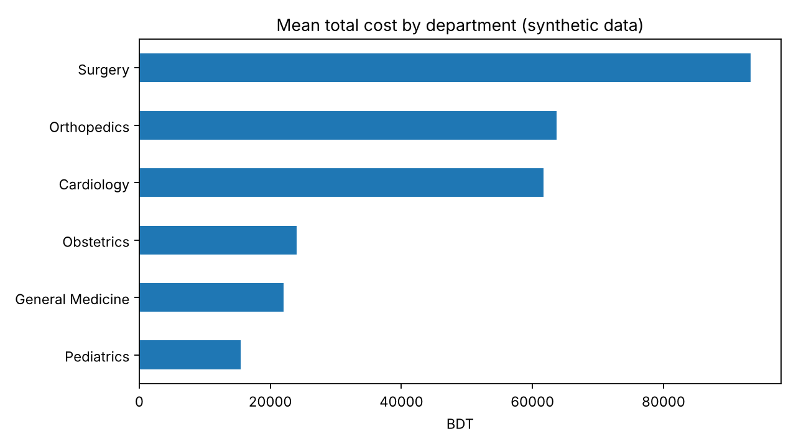

# Healthcare Data Analysis and Power BI Dashboard

## Project Overview
A portfolio project that cleans and analyses a healthcare admissions dataset with Python and prepares it for a Power BI dashboard.

## Status
- **Done:** data cleaning script, Python analysis (department costs, readmission, satisfaction, trends), charts, and a findings report.
- **Not done:** the Power BI dashboard itself (it must be built in Power BI Desktop) and analysis of a real public dataset.

## Dataset
This project currently uses a **synthetic (simulated) dataset**, not real patient data. See [Datasets/synthetic-healthcare](../../Datasets/synthetic-healthcare/) for the data dictionary and generator.
- Rows / columns: 2,010 x 13 (includes 10 deliberate duplicates and some missing values)
- Every result describes the simulation only and must not be presented as a real healthcare finding.

To use a real public dataset instead (for example from Kaggle), record its source and license, place the file at `data/raw/healthcare.csv`, check that it has the columns listed in `src/analyze.py`, and run the analysis with `--no-synthetic`.

## Run It
```bash
python -m pip install -r requirements.txt
python src/prepare_data.py --input ../../Datasets/synthetic-healthcare/synthetic_healthcare_patients.csv --output data/processed
python src/analyze.py
```

- `prepare_data.py` standardises column names, trims text, parses dates, removes exact duplicates, and writes `data/processed/healthcare_clean.csv` plus a `cleaning_log.csv` of every change.
- `analyze.py` writes summary tables, three charts, and `outputs/findings.md`. Every number in the report is produced by the script.

## Results (synthetic data)
Full report: [outputs/findings.md](outputs/findings.md)



Headline results from the simulation (see the report for tests and limitations):
- Mean cost ranges from about 15,400 BDT (Pediatrics) to about 93,300 BDT (Surgery).
- Length of stay and cost are strongly correlated (Spearman rho = 0.80).
- 30-day readmission rises with age group (about 5-6% under 45, about 9-11% from 45), a small effect (Cramér's V = 0.078).
- Longer stays go with slightly lower satisfaction scores (rho = -0.13).

These patterns were built into the simulation, so they show that the analysis code works, not anything about real healthcare.

## Repository Structure
```
healthcare-dashboard/
├── data/
│   ├── raw/          # Place a downloaded dataset here (not committed)
│   └── processed/    # Cleaned data and cleaning log (not committed)
├── outputs/          # Findings report, summary tables, charts
├── src/
│   ├── prepare_data.py
│   └── analyze.py
├── requirements.txt
└── README.md
```

## Power BI Dashboard Plan (not yet built)
Load `data/processed/healthcare_clean.csv` into Power BI Desktop and build:

| Page | Purpose |
|---|---|
| Overview | Admissions, mean length of stay, mean cost, readmission rate |
| Patient demographics | Age group, gender, and division distributions |
| Cost and stay | Cost and length of stay by department and diagnosis |
| Trends | Monthly admissions over time |

When the dashboard exists, add screenshots to `outputs/` and link them here.

## Limitations
- Simulated data: relationships were designed in, so results cannot be generalised.
- Observational data; associations are not causal.
- Several tests were run without multiple-comparison correction.
- Missing `insurance_type` and `satisfaction_score` values were left missing and excluded only from the tests that use them.
