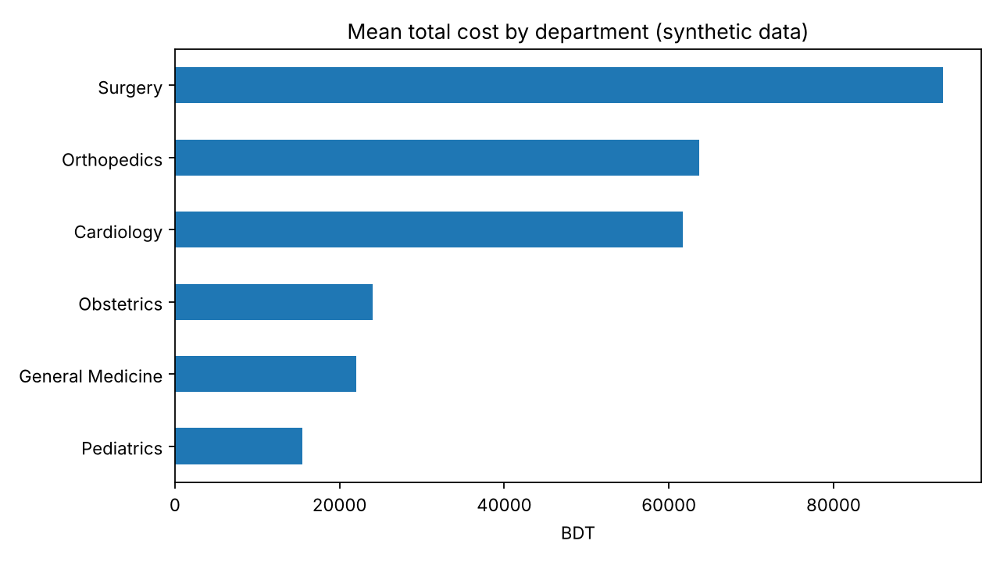
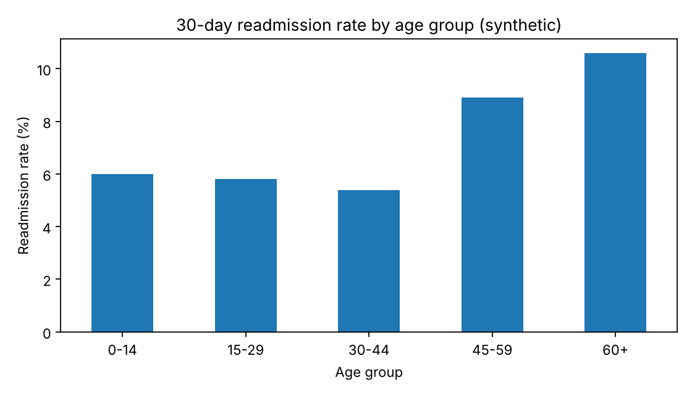
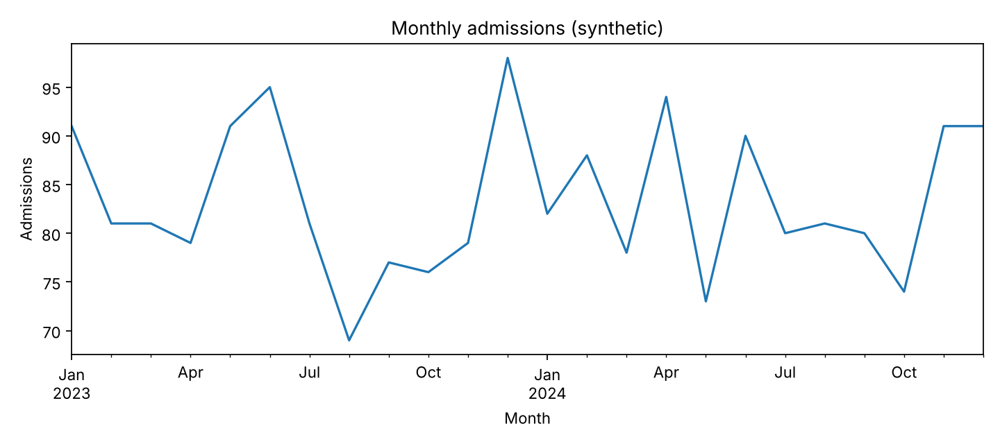

# Healthcare Analysis: Findings

> WARNING: SYNTHETIC DATA. These results describe a simulation and say nothing about real patients or hospitals.

## Data
- Records analysed: 2,000
- Admission dates: 2023-01-01 to 2024-12-30
- Missing `insurance_type`: 20; missing `satisfaction_score`: 60 (excluded from the tests that use them)
- Overall 30-day readmission rate: 7.4%

## Cost and length of stay by department
| department       |   patients |   mean_los_days |   mean_cost_bdt |   median_cost_bdt |   readmission_rate_pct |
|:-----------------|-----------:|----------------:|----------------:|------------------:|-----------------------:|
| Surgery          |        313 |             7.4 |         93277   |             84550 |                    5.4 |
| Orthopedics      |        245 |             7.6 |         63701.8 |             60900 |                    6.9 |
| Cardiology       |        297 |             6.6 |         61648.3 |             58200 |                   12.8 |
| Obstetrics       |        274 |             3.9 |         24005.3 |             21750 |                    5.8 |
| General Medicine |        600 |             5.3 |         22054.2 |             20600 |                    7   |
| Pediatrics       |        271 |             4.1 |         15436.9 |             13650 |                    7   |

- Highest mean cost: Surgery (93,277 BDT); lowest: Pediatrics (15,437 BDT).
- Kruskal-Wallis test of cost across departments: H = 1276.1, p < 0.001.
- Spearman correlation, length of stay vs cost: rho = 0.80, p < 0.001.

## Readmission
| age_group   |   readmission_rate_pct |
|:------------|-----------------------:|
| 0-14        |                    6   |
| 15-29       |                    5.8 |
| 30-44       |                    5.4 |
| 45-59       |                    8.9 |
| 60+         |                   10.6 |

- Readmission vs age group: chi-square = 12.26, df = 4, p 0.016, Cramér's V = 0.078.
- Readmission vs insurance type: chi-square = 2.91, df = 3, p 0.405, Cramér's V = 0.038.

## Patient satisfaction
- Spearman correlation, length of stay vs satisfaction: rho = -0.13, p < 0.001 (n = 1,940).

## Charts




## Limitations
- Observational data: associations do not show cause and effect.
- Several tests were run without a multiple-comparison correction; treat single p-values cautiously.
- 0% of expected counts in the age-group readmission table are below 5.
- Costs are right-skewed, so medians are shown next to means.
- The data are simulated; the relationships found were built into the simulation.

## Reproducibility
```bash
python src/prepare_data.py --input ../../Datasets/synthetic-healthcare/synthetic_healthcare_patients.csv --output data/processed
python src/analyze.py
```
